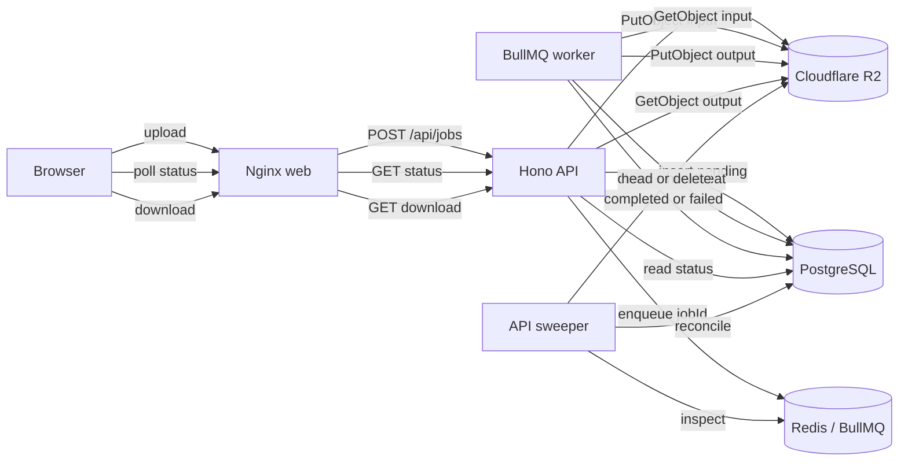

# ts-upload-image

Upload a JPG, PNG, or WebP. The API stores the original, a BullMQ worker resizes and converts it with Sharp, and the browser polls until the WebP is ready to download.

## Stack

| Layer | Choice |
|---|---|
| API | Hono on Bun |
| Worker | BullMQ, Sharp, Bun |
| Metadata | PostgreSQL 17 |
| Queue | Redis 7, BullMQ |
| Files | Cloudflare R2 through the S3 API |
| Web | Svelte 5, Vite, Tailwind CSS 4 |
| Migrations | dbmate |
| Local runtime | Docker Compose |

## Quick start

Requirements: Docker with Compose, a Cloudflare R2 bucket, and R2 API credentials.

```sh
cp .env.example .env
```

Fill the `S3_*` values in `.env`. If `.env` already exists, edit it instead of copying over it.

```sh
docker compose up --build
```

The migration job runs before the API and worker. Nginx waits for the API health check. Open `http://localhost:8080`.

The browser talks to Nginx on port 8080. Nginx proxies `/api` and `/health` to the API on port 3000, so the browser and API share an origin and no CORS setup is needed.

Stop the stack with `docker compose down`. Add `-v` if you also want to delete the PostgreSQL volume.

## Environment variables

Compose reads these values from `.env`. The file is ignored by Git.

| Variable | Used by | Notes |
|---|---|---|
| `POSTGRES_USER` | PostgreSQL, API, worker | Defaults to `app` |
| `POSTGRES_PASSWORD` | PostgreSQL, API, worker | Defaults to `app` for local use |
| `POSTGRES_DB` | PostgreSQL, API, worker | Defaults to `app` |
| `S3_ENDPOINT` | API, worker | For R2, use `https://<account-id>.r2.cloudflarestorage.com` |
| `S3_REGION` | API, worker | Use `auto` for R2 |
| `S3_BUCKET` | API, worker | Bucket must already exist |
| `S3_ACCESS_KEY_ID` | API, worker | R2 access key |
| `S3_SECRET_ACCESS_KEY` | API, worker | R2 secret key |
| `S3_FORCE_PATH_STYLE` | API, worker | `false` for R2 |
| `PORT` | API | Set by Compose to 3000 |
| `QUEUE_NAME` | API, worker | Defaults to `image-processing` |
| `DB_LEASE_MS` | Worker | Defaults to 20000 |
| `DB_HEARTBEAT_MS` | Worker | Defaults to 10000 |

The bucket stays private. Both the API and the worker use the same credentials. The browser never receives R2 credentials.

## API

All errors use one envelope:

```json
{
  "error": {
    "code": "JOB_NOT_READY",
    "message": "Job belum selesai diproses.",
    "retryable": true
  }
}
```

### `POST /api/jobs`

Multipart form data with an `image` field. The server checks the size and the file signature before it stores anything.

Success returns `202 Accepted`:

```json
{
  "job_id": "0193a2f4-8b12-7c90-a1b2-3c4d5e6f7a8b",
  "status": "pending",
  "created_at": "2026-11-19T09:30:00.000Z"
}
```

The response also includes `Location: /api/jobs/<job_id>`.

Validation errors: `400 MISSING_FILE`, `400 EMPTY_FILE`, `413 FILE_TOO_LARGE`, `415 UNSUPPORTED_FILE_TYPE`.

### `GET /api/jobs/:jobId`

Returns `200` for every state that exists. A failed job is still a valid resource, so the endpoint returns its state and error:

```json
{
  "job_id": "0193a2f4-8b12-7c90-a1b2-3c4d5e6f7a8b",
  "status": "failed",
  "created_at": "2026-11-19T09:30:00.000Z",
  "updated_at": "2026-11-19T09:30:04.000Z",
  "failed_at": "2026-11-19T09:30:04.000Z",
  "error": {
    "code": "IMAGE_DIMENSIONS_EXCEEDED",
    "message": "Image exceeds the maximum of 25000000 pixels.",
    "retryable": false
  }
}
```

Completed jobs include `completed_at` and a relative `download_url`. Unknown or malformed IDs return `404 JOB_NOT_FOUND`.

### `GET /api/jobs/:jobId/download`

The API checks the database before it reads R2. The object is streamed through the API.

| State | Response |
|---|---|
| `completed` and object exists | `200` with `Content-Type: image/webp` |
| `pending` or `processing` | `409 JOB_NOT_READY`, `Retry-After: 1` |
| `failed` | `410 JOB_FAILED` |
| Completed but object is gone | `410 OUTPUT_UNAVAILABLE` |
| R2 is temporarily unavailable | `503 STORAGE_UNAVAILABLE` |
| Unknown job | `404 JOB_NOT_FOUND` |

Download responses include `Content-Disposition`, `Cache-Control: private, no-store`, and `X-Content-Type-Options: nosniff`.

`GET /health` returns `{ "status": "ok" }` for the Compose health check.

## Processing rules

- Accepted input: JPG, PNG, and WebP, up to 20 MB.
- Validation uses the file signature, not the MIME header supplied by the client.
- The worker rejects files above 25 megapixels before a full decode.
- Animated WebP and APNG are accepted. Only the first frame is processed, so the result is a static WebP.
- EXIF orientation is applied before resizing.
- The longest side is resized to 1280 px. Smaller images are not enlarged.
- Output is WebP at quality 80.
- Alpha is preserved. Metadata is stripped.
- The worker runs Sharp with one libvips worker and the Sharp cache disabled. Compose limits the worker to 512 MB and BullMQ concurrency is 1.

## Architecture



PostgreSQL is the system of record for job state. Redis carries job delivery and locks. R2 stores input and output objects with deterministic keys:

```text
inputs/<jobId>
outputs/<jobId>.webp
```

The API uses UUIDv7 for job IDs and returns ISO 8601 UTC timestamps.

### Claim and fencing

A worker claims a job with one conditional update. It can take a `pending` job or a `processing` job whose lease has expired:

```sql
UPDATE jobs
SET status = 'processing',
    run_id = $runId,
    attempts = attempts + 1,
    lease_expires_at_ms = $now + $leaseMs
WHERE id = $jobId
  AND (
    status = 'pending'
    OR (status = 'processing' AND lease_expires_at_ms < $now)
  )
RETURNING input_key;
```

`run_id` fences stale workers. A worker that wakes after a stall cannot complete or fail the job unless its `run_id` still owns the row. The worker renews the lease every 10 seconds. The database lease is 20 seconds and the BullMQ lock is 30 seconds, so a dead worker's database lease expires before the queue requeues the job.

The worker checks ownership before uploading output. That prevents a stale worker from writing an artifact after the job has reached a terminal state.

### Queue publish failure

The API writes the `pending` row before it publishes to Redis. If Redis is down, the API still returns `202` because the database row is durable. The sweeper finds old pending jobs that have no queue entry and publishes them again with the same job ID.

A client retry after a network timeout can still create a second job. The API does not implement an idempotency key.

### Sweeper

The sweeper runs inside the API process. A PostgreSQL advisory lock keeps multiple API instances from sweeping at the same time. It handles three groups:

- `pending`: enqueue when the queue entry is missing; mark completed when a terminal queue job has a valid artifact; mark failed when a terminal queue job has no artifact.
- `processing`: skip `active` queue jobs; promote to `completed` when the artifact exists; reset to `pending` when the queue job is waiting or delayed; mark failed when the queue entry is gone.
- `failed`: delete the output object once and record `artifacts_cleaned_at_ms`.

`failed` is terminal. A worker checks ownership before it uploads output, which prevents most late writes. The sweeper deletes failed artifacts and records `artifacts_cleaned_at_ms`. The download endpoint never serves a file based on object existence alone; it checks the database state first.

### Download path

The download goes through the API instead of a presigned URL. This keeps the bucket private, lets the API reject failed jobs before reading R2, and avoids exposing a URL that remains valid after the job state changes. The cost is that download bandwidth passes through the API.

## Testing

```sh
bun run test
bun run typecheck
bun run web:check
bun run web:build
```

For tests against the running stack, keep Compose up and use the same `.env`:

```sh
bun run test:e2e
bun run test:e2e:recovery
bun run test:browser
```

The unit and integration tests cover the image pipeline, queue error mapping, API validation and responses, polling backoff, file validation, and sweeper decisions. They use fakes for PostgreSQL, Redis, and R2. 42 tests pass.

The API E2E suite talks to the running API and worker, writes to the configured R2 bucket, and deletes the job rows and objects it creates. It covers a valid JPEG upload and WebP download, rejection above 25 MP, missing files, oversize files, spoofed MIME, and unknown jobs. 6 tests pass.

The recovery test kills the worker while a 25 MP job is processing, waits for the lease and BullMQ stalled check, restarts the worker, and expects the job to complete. It takes about 70 seconds and passes.

The Playwright test drives the Svelte UI in Chrome, uploads a JPEG, waits for the completed state, and downloads the WebP. A second test checks the client-side error for an unsupported file type. 2 browser tests pass.

API and worker type checks pass. Svelte check reports no errors. Vite production build succeeds. `e2e/README.md` explains prerequisites, cleanup, and the separate commands.

## Project layout

```text
apps/
  api/        Hono API, upload, status, download, sweeper
  worker/     BullMQ worker and Sharp pipeline
  web/        Svelte 5 SPA, Vite, Tailwind
packages/
  shared/     Error codes and job status types
  db/         PostgreSQL repository, dbmate migrations, schema.sql
  storage/    R2/S3 adapter
e2e/          API end-to-end tests against the running stack
docker-compose.yml
```

## Design

Tailwind CSS 4 maps the interface tokens in `apps/web/src/app.css`: cream canvas, near-black primary buttons, 12 px controls, 24 px cards, and the project brand palette.

Plain Black is not available as a public font, so the interface uses Inter as the fallback for display text, with negative letter spacing. The interface keeps the cream canvas and uses one light theme.

## Limitations

- There is no authentication or user account model. A job ID acts as an unguessable capability.
- There is no rate limiting on uploads.
- Input objects and completed output objects have no TTL cleanup. Only failed output artifacts are deleted by the sweeper.
- Animated inputs produce a static first frame.
- A failed job requires a new upload. The same job is never retried after `failed`.
- The stack runs as a single API instance and a single worker instance. The advisory lock makes the sweeper safe with multiple API replicas, but the queue and database are not tuned for high availability.
- The E2E suites need a running stack and real R2 credentials. Download-before-ready and a Redis outage during upload are not automated.
